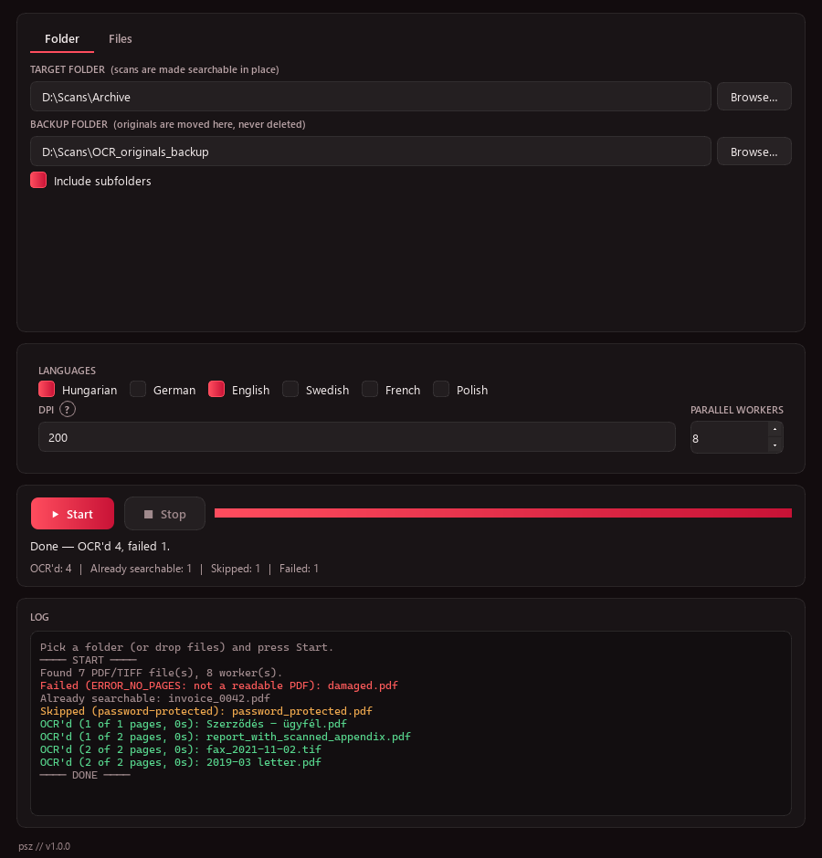
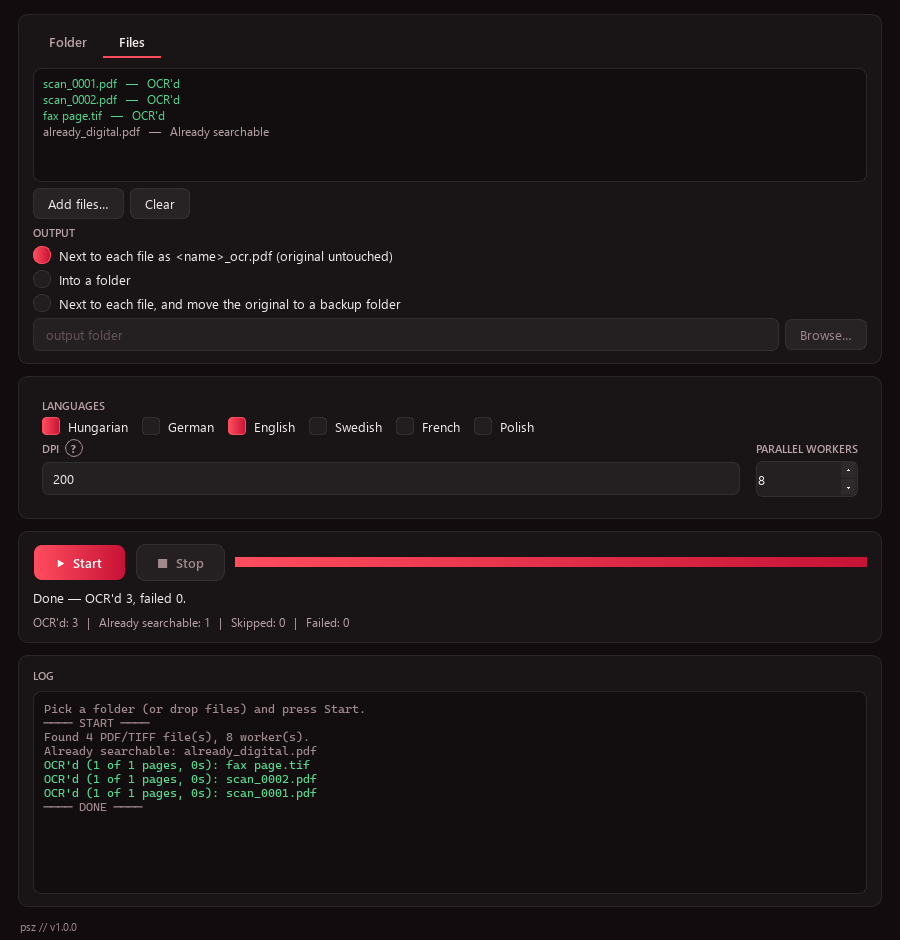
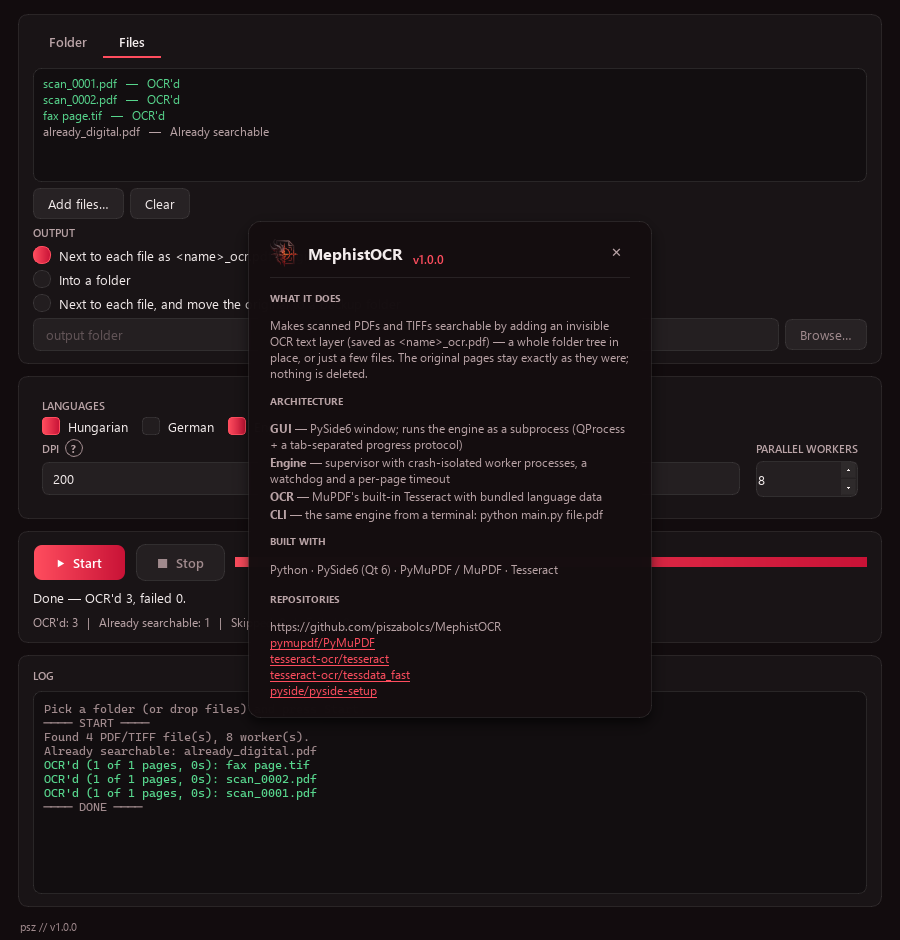
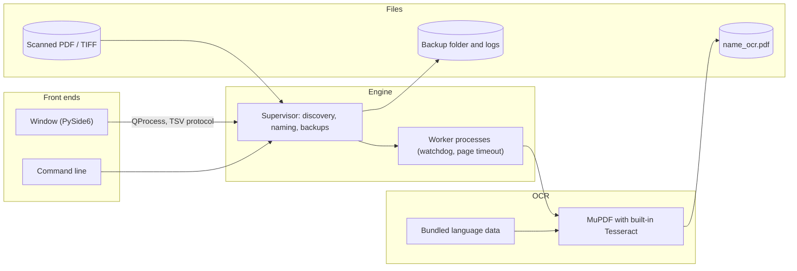

<div align="center">


# MephistOCR

**Make scanned PDFs and TIFFs searchable with an invisible OCR text layer**


[Features](#features) · [Screenshots](#screenshots) · [Architecture](#architecture) · [Installation](#installation)

</div>

<p align="center">
  
</p>

## The problem

A scanned PDF or a TIFF fax is only a picture of text: full-text search, search indexes and RAG knowledge
bases cannot see a single word in it. Real archives mix scans, born-digital PDFs and PDFs with a few
scanned pages, so redoing every file wastes hours, and re-rendering pages costs image quality, links and
bookmarks. On a large archive one damaged or hanging file can also stop a whole overnight run.

## The solution

MephistOCR adds an invisible OCR text layer only to the pages that are images without real text and leaves
the original page content untouched. It works on a whole folder tree, where the originals are moved (never
deleted) into a backup folder, or on a few dropped files. OCR runs in separate worker processes with a
per-page timeout and a watchdog, and a stopped run simply continues where it left off.

## Features

- **Folder mode.** Processes a whole folder tree, saves `<name>_ocr.pdf` next to each original and moves the original into a backup folder that mirrors the tree.
- **Files mode.** Drop a few PDFs or TIFFs; the result goes next to each file, into a chosen folder, or replaces the original with a backup.
- **Only the pages that need it.** Pages with real text are left alone, so a mixed PDF gets OCR on its scanned pages only.
- **Faithful output.** Pages are not re-rendered: image resolution, links, annotations, bookmarks and metadata are kept, and multi-page TIFFs become PDFs with the correct page size.
- **Fault isolation.** A file that crashes a worker is reported as failed, a page that hangs for 5 minutes is stopped, and the run goes on.
- **Resumable and non-destructive.** Files that already have an `_ocr.pdf` are skipped, name clashes get `_1`, `_2` suffixes, nothing is overwritten.
- **No Tesseract install.** MuPDF's built-in Tesseract with bundled Hungarian, German, English and Swedish data; more languages by dropping a `.traineddata` file into `mephistocr/tessdata/`.
- **Command line.** The same engine from a terminal, with JSON output and exit codes for scripts.

## Screenshots

<table>
  <tr>
    <td align="center" width="50%"><br/><sub>Files mode: dropped files with their result per row</sub></td>
    <td align="center" width="50%"><br/><sub>The footer opens the app info card</sub></td>
  </tr>
</table>

The screenshots are rendered offscreen from generated demo files by `tools/make_screenshots.py`: scans, a
TIFF fax and a mixed PDF are OCR'd, a born-digital PDF is left alone, a password-protected file is skipped
and a damaged one is reported.

## Architecture



The window never runs OCR itself: it starts the engine as a separate process and reads a tab-separated
protocol (`START`, `PROG`, `LOG`, `FILE`, `DONE`, `FATAL`) from its stdout, so it stays responsive however
long a page takes. The engine finds the files, plans output names, hands pages to a pool of worker
processes and moves the originals into the backup folder. The command line drives the same engine without
a window, and a built exe relaunches itself with `--worker` for the same purpose.

## Tech stack

| Layer | Technology |
|---|---|
| Language | Python 3.12 |
| Desktop UI | PySide6 (Qt 6), `QProcess` for the engine |
| PDF and OCR | PyMuPDF 1.28 (MuPDF with built-in Tesseract) |
| Language data | Tesseract `tessdata_fast`: hun, deu, eng, swe |
| Concurrency | `multiprocessing` worker pool with watchdog and page timeout |
| Packaging | PyInstaller (onedir build) |
| Tests | pytest, pytest-qt (offscreen), Pillow for generated fixtures |

## Installation

Prerequisites: Windows 10 or 11 and Python 3.12. No separate Tesseract installation is needed.

1. Clone the repository:
   ```powershell
   git clone https://github.com/piszabolcs/mephistocr.git
   cd mephistocr
   ```
2. Create the virtual environment and install the dependencies:
   ```powershell
   py -3.12 -m venv .venv
   .venv\Scripts\python.exe -m pip install -r requirements.txt
   ```
3. Start the app:
   ```powershell
   .venv\Scripts\python.exe main.py
   ```
4. Optional, build the standalone app (a folder, about 170 MB with the four bundled languages).
   `build.bat` uses the `python` on PATH, so activate the virtual environment first:
   ```powershell
   .venv\Scripts\activate
   build.bat
   ```
   The result is `dist\MephistOCR\MephistOCR.exe`; it also works as the command line.
5. Optional, run the tests (offscreen, no window appears):
   ```powershell
   .venv\Scripts\python.exe -m pip install -r requirements-dev.txt
   .venv\Scripts\python.exe -m pytest -q
   ```

## Usage

1. **Folder tab:** choose the target folder and a backup folder (it must not be the target, inside it, or
   contain it), tick the languages and press **Start** (or Enter).
2. **Files tab:** drop files anywhere on the window, choose where the result goes and press Start.
   Double-click a finished row to open the result; right-click for *Show in folder*.
3. Every file gets a colour-coded log line: green OCR'd, grey already searchable, amber skipped (with the
   reason), red failed (with the reason).

Command line:

```powershell
python main.py scan.pdf fax.tif                       # <name>_ocr.pdf next to each file
python main.py scan.pdf --out D:\OCR                  # results into D:\OCR
python main.py scan.pdf --replace --backup D:\Orig    # originals moved to D:\Orig
python main.py --folder D:\Archive --backup D:\Archive_originals
python main.py --help                                 # --lang hun+eng, --dpi, --workers, --force, --json
```

Exit codes: `0` everything done, `1` at least one file failed, `2` usage error or the run could not start.

Notes:

- Window settings live in `%LOCALAPPDATA%\MephistOCR\settings.ini` (nothing is written to the registry).
  The run log (`_ocr_log.tsv`) and engine errors (`_ocr_stderr.log`) go to the backup folder, or to
  `%LOCALAPPDATA%\MephistOCR\logs\` for runs without one. `MEPHISTOCR_HOME` overrides both locations.
- No network access, no telemetry, no autostart. Originals are moved, never deleted; outputs are written to
  a `.tmp` file first and renamed when complete. Encrypted PDFs are skipped, never decrypted.
- Known limits: pages scanned sideways without a rotation flag are not auto-rotated; a page counts as
  scanned when it shows an image and has fewer than 20 extractable characters; files over 1200 pages are
  skipped.

## Project structure

```text
mephistocr/
├── main.py                   # entry point: window, command line or --worker
├── mephistocr/               # application package
│   ├── engine.py             # OCR engine, worker pool, watchdog, TSV protocol
│   ├── cli.py                # command-line front end
│   ├── main_window.py        # Folder and Files tabs, runs the engine through QProcess
│   ├── signature.py          # footer signature and About card
│   ├── theme.py              # palette and Qt stylesheet
│   ├── win_frame.py          # dark Windows caption
│   ├── assets/               # icon and mark
│   └── tessdata/             # bundled language data
├── tests/                    # pytest and pytest-qt, offscreen, generated PDFs and TIFFs
├── tools/                    # icon and screenshot generators
├── docs/                     # logo and screenshots
├── MephistOCR.spec           # PyInstaller onedir build
├── build.bat                 # builds dist\MephistOCR\
└── THIRD_PARTY_NOTICES.md    # licences of PyMuPDF, PySide6 and the language data
```

## Roadmap

- [ ] Detect page orientation and rotate sideways scans before OCR.
- [ ] Settle the licence of built releases (AGPL-3.0 or a commercial PyMuPDF licence), then publish the exe as a GitHub Release.
- [ ] Make the scanned-page threshold and the page limit configurable.

## License

MIT, see [LICENSE](LICENSE). MephistOCR depends on **PyMuPDF, which is AGPL-3.0** (or commercially licensed
by Artifex): running from source is unaffected, but distributing a built exe brings AGPL obligations for the
combined work. PySide6 is LGPL-3.0 and the bundled Tesseract language data is Apache-2.0; details are in
[THIRD_PARTY_NOTICES.md](THIRD_PARTY_NOTICES.md).

---

<div align="center">
<sub>Built by Szabolcs Pintér · <a href="https://github.com/piszabolcs">GitHub</a> · <a href="https://www.linkedin.com/in/piszabolcs">LinkedIn</a></sub>
</div>
